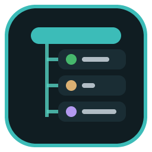

# Callboard Panels

Callboard Panels is the VS Code side of **callboard**, the Claude Code mod that lets one session (a *lead*) run other sessions (*lanes*) in the same repo. The mod handles the cues. This extension opens and closes the Claude Code panels the lanes live in.

## What it does

- **Opens a lane.** A lead's `lane_open` writes a request under `~/.claude/callboard/open/`. The window whose first folder is that lane's folder opens one Claude Code panel, finds its session id by diffing the session registry (one open at a time) and answers with it. The lead then names it and starts it.
- **Reopens a parked lane.** For `lane_unpark`, it answers `<LANE>.reopen` (the saved session id, one line) by reopening that exact conversation as a panel, but only when the lane's record names that session id.
- **Closes finished panels.** Every 2 seconds it checks the panels it opened and closes a panel's tab once that session's registry entry is gone and its process is dead. It closes one matching Claude tab only and never a panel with a reserved name. The conversation history stays.
- **Closes the tab of a stopped lane.** After `lane_retire`, `lane_park` or `lane_terminate` sent the signal, the lead's mod also writes `~/.claude/callboard/open/<LANE>.close` (session id, pid and lane name, three lines). The window that has the lane folder open adds that panel to the same sweep, so the tab of an attached lane, or one resumed by hand, closes too, under the same rules. Nothing is answered and nothing happens in a terminal. A request is written only when the signal exited 0, and an adopted panel that no registry entry shows within 5 minutes is dropped.

It doesn't touch the terminal, any setting or the network. It reads and writes request files under `~/.claude/callboard`, reads `~/.claude/sessions` and the lane store under `~/.claude/callboard/lanes`, and runs `/bin/ps` to check a session's process.

## Requirements

- The **Claude Code** extension (`anthropic.claude-code`). It's declared as a dependency.
- The **callboard mod**, loaded from your checkout of the ai-manager repo. This extension is a link into the same checkout, made by callboard's `link-extension.sh`. It isn't on the Marketplace.

## Things to know

- **One repo per window.** Claude Code opens a new panel in the window's *first* folder, so a window answers only for lanes in that folder. In a multi-root workspace, lanes of the other folders need their own window.
- **Limits.** At most 6 panels a minute. A lane made by a lead is refused when its repo already has 8 live sessions. A lane that already has a live session is refused.
- **Focus stays put.** A panel it opens doesn't keep focus: the tab you were on comes back.

## Updating

When the version changed: quit VS Code (Cmd+Q), pull the checkout, run callboard's `link-extension.sh --apply` from a plain Terminal, then reopen VS Code. A new version keeps the same id, and the script replaces the old version's link and its entry in VS Code's `extensions.json`.

More in the callboard README in the [ai-manager repo](https://github.com/notitial/ai-manager).
